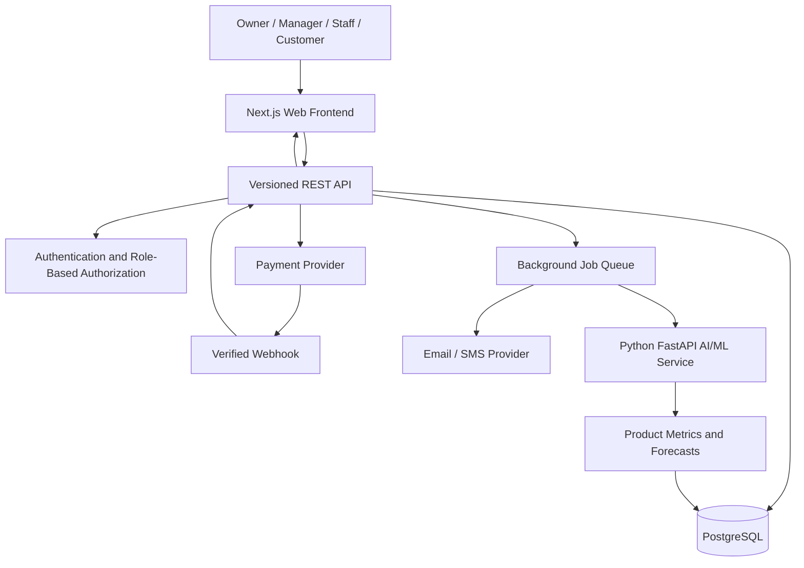
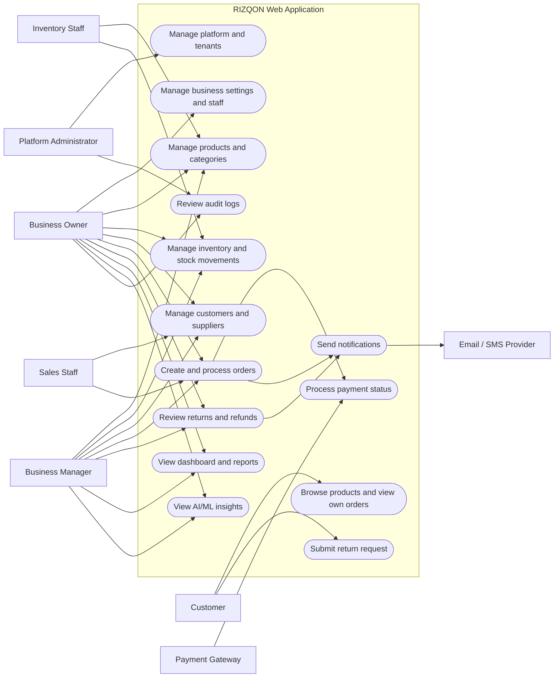
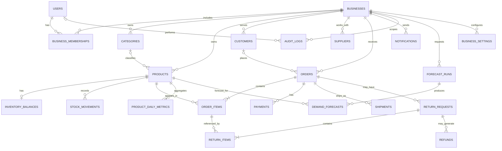

# RIZQON
## Multi-Business Management Platform with AI/ML-Based Business Analysis
### Final Project Report

**Project:** RIZQON  
**Project category:** Web Application / Multi-Tenant Business Management / AI and Machine Learning  
**Document type:** Final project design and implementation report  
**Version:** 1.0  
**Date:** 10 October 2026  
**Status:** Proposed system design and database implementation blueprint

---

## Abstract

RIZQON is a proposed multi-business management web application designed to help multiple independent businesses manage products, inventory, customers, suppliers, orders, payments, returns, shipments, notifications, and business reports through a centralized platform. The system follows a multi-tenant architecture, meaning that several businesses can use the same application while their business records and access permissions remain logically separated.

The project combines conventional business-management functions with an Artificial Intelligence and Machine Learning (AI/ML) analysis layer. The analytics layer is intended to identify best-selling products, highlight low-stock and slow-moving inventory, summarize business performance, and generate demand forecasts when sufficient historical data is available. Recommendations are presented as decision support, with relevant metrics and limitations, rather than as guaranteed predictions or automatic purchasing decisions.

The proposed implementation uses a Next.js/React frontend, a TypeScript-based REST API, PostgreSQL for transactional data, Prisma for database modelling and migrations, and a Python/FastAPI service for analytics and forecasting. The database blueprint contains 22 core tables covering identity, tenant membership, products, inventory, customers, suppliers, orders, payments, returns, shipments, notifications, audit logs, and forecasting. Approximately 63 REST API endpoints are estimated across the proposed modules; the final number depends on detailed requirements and integration choices.

This report documents the project background, objectives, scope, requirements, architecture, workflows, use case diagram, database design and ER diagram, API design, AI/ML approach, security, testing, implementation phases, limitations, and conclusion. The schema and endpoint counts are design deliverables and estimates; they do not imply that a live production deployment or all application APIs have already been completed.

**Keywords:** RIZQON, business management system, multi-tenant architecture, inventory management, REST API, PostgreSQL, Prisma, artificial intelligence, machine learning, demand forecasting.

---

## Table of Contents

1. Introduction
2. Problem Statement
3. Aim and Objectives
4. Project Scope
5. Proposed Users and Roles
6. Requirements Analysis
7. System Architecture
8. Web Application Workflow
9. Use Case Diagram
10. Database Design
11. Entity-Relationship Diagram
12. REST API Design
13. AI/ML Methodology
14. Security, Privacy, and Reliability
15. Testing and Quality Assurance
16. Implementation Plan
17. Risks and Mitigations
18. Expected Outcomes and Evaluation
19. Limitations and Future Enhancements
20. Conclusion
21. References and Technical Documentation
22. Appendix A: Core Table Inventory
23. Appendix B: Example API Transaction
24. Appendix C: Suggested Project Structure

---

## 1. Introduction

Businesses often need to coordinate product catalogues, stock levels, customers, orders, payments, returns, employees, and performance reports. When these activities are managed using separate tools or spreadsheets, records can become inconsistent, stock information can be outdated, and it can be difficult to identify trends in sales.

RIZQON is designed as a centralized web application for multiple independent businesses. It provides common business operations in one platform while applying tenant-based access controls to keep each business's records separate. The application is intended to support business owners, managers, staff, and—if a customer-facing storefront is enabled—customers.

In addition to operational management, RIZQON proposes an AI/ML layer that analyses historical and current business data. The initial focus is on understandable insights, such as product sales rankings and low-stock alerts, followed by baseline demand forecasting after enough reliable history has been collected.

The development principle is to establish secure, accurate transaction processing before relying on predictive analytics. AI/ML recommendations depend on the quality and coverage of the underlying business data.

## 2. Problem Statement

Small and medium businesses may use different systems to manage stock, orders, customer information, returns, and reporting. This can create several problems:

- Data is distributed across multiple tools.
- Stock balances may not match actual movements.
- Order and return status can be difficult to track.
- Owners may lack a consolidated view of business performance.
- Historical sales data may not be used systematically for demand planning.
- Shared software can expose data across businesses if tenant access is not enforced correctly.

RIZQON addresses these issues by proposing one platform for business operations, traceable transactions, role-based permissions, and data-supported business analysis.

## 3. Aim and Objectives

### 3.1 Aim

To design a secure, modular, multi-tenant business management web application that centralizes business operations and provides explainable AI/ML insights for operational decision support.

### 3.2 Specific objectives

1. Support multiple businesses on a shared application with logical data isolation.
2. Provide secure user authentication and role-based authorization.
3. Manage product catalogues, categories, suppliers, and inventory.
4. Record stock changes as traceable movements.
5. Manage customers, orders, order items, and order status transitions.
6. Integrate payment providers without storing raw card credentials.
7. Track return requests, refunds, and shipment statuses.
8. Provide dashboards, business reports, notifications, and audit logs.
9. Analyse sales and inventory data to identify top-selling and slow-moving products.
10. Introduce demand forecasting with suitable evaluation and uncertainty reporting.
11. Define a maintainable database schema and versioned REST API.
12. Test security, transaction integrity, tenant isolation, and key workflows.

## 4. Project Scope

### 4.1 Included in the proposed MVP

- User identity and business memberships
- Business settings
- Product categories and product management
- Inventory balances and stock movement history
- Customer and supplier records
- Order and order-item management
- Payment references and provider webhook handling
- Return requests, return items, and refund tracking
- Shipment tracking records
- Notifications and audit logs
- Sales and inventory reporting
- Product daily metrics and forecast records
- Basic AI/ML analytics and baseline demand forecasting

### 4.2 Excluded from the initial scope unless separately approved

- Full accounting and tax filing
- Payroll and human-resources management
- Advanced procurement and purchase-order workflows
- Multiple warehouse transfers
- Native Android/iOS applications
- Fully autonomous purchasing or pricing decisions
- Guaranteed prediction of future sales
- Every possible payment, courier, and messaging provider

### 4.3 Assumptions

- RIZQON is intended to serve multiple businesses.
- The initial client is a responsive web application.
- PostgreSQL is the primary database.
- Payment, messaging, and hosting providers will be selected for the launch market.
- Customer-facing storefront functions are optional and must be confirmed during detailed requirements.
- AI/ML outputs are advisory and require human review.

## 5. Proposed Users and Roles

| Role | Main responsibilities |
|---|---|
| Platform administrator | Manage platform-level settings and tenant lifecycle; controlled support access |
| Business owner | Configure business settings, invite staff, manage operations, review reports |
| Business manager | Manage products, inventory, orders, returns, and authorized reports |
| Inventory staff | View products and perform permitted stock movements |
| Sales/order staff | Create orders and maintain customer records within assigned permissions |
| Customer | If a storefront is enabled, browse products, view their own orders, and request eligible returns |
| Background service | Process queued notifications, forecasts, and verified payment events with restricted credentials |

A user's access should be determined by verified membership and server-side permissions. Hiding a button in the frontend is not a security control.

## 6. Requirements Analysis

### 6.1 Functional requirements

**FR-01 — Authentication:** Users can sign in and sign out securely. Passwords managed by RIZQON must be stored as strong password hashes.

**FR-02 — Business management:** Authorized users can create, view, and update business profiles and memberships.

**FR-03 — Product management:** Authorized staff can create, search, update, categorize, and archive products.

**FR-04 — Inventory management:** The system maintains inventory balances and records every meaningful stock movement. Stock changes must follow defined transaction rules.

**FR-05 — Customer management:** Staff can maintain customer profiles and review relevant order history.

**FR-06 — Supplier management:** Authorized users can maintain supplier contact information.

**FR-07 — Order management:** Orders contain line items and move through valid statuses. Prices and totals are calculated by the backend, not trusted from the browser.

**FR-08 — Payment processing:** The backend initiates payment-provider operations, stores provider references, and verifies payment webhooks.

**FR-09 — Returns and refunds:** The system records return requests, review decisions, received items, refund status, and restocking decisions.

**FR-10 — Shipment tracking:** The system records carrier, tracking reference, and shipment status when shipping integration is used.

**FR-11 — Reporting:** Authorized users can view sales, order counts, inventory levels, returns, and product performance.

**FR-12 — AI/ML insights:** The system can provide top-product rankings, low-stock signals, slow-moving stock analysis, and demand forecasts where data supports them.

**FR-13 — Notifications:** The system can queue and send transactional email, SMS, or in-app notifications through configured providers.

**FR-14 — Audit logs:** Important actions are recorded with business, actor, action, entity reference, and timestamp.

**FR-15 — Business settings:** Authorized users can configure currency, timezone, and other business policies supported by the application.

### 6.2 Non-functional requirements

- **Security:** HTTPS, least privilege, secure secrets, server-side validation, and verified webhooks.
- **Tenant isolation:** Business records must not be visible or editable by unauthorized tenants.
- **Reliability:** Backups, restore testing, safe retries, and clear failure handling.
- **Performance:** Pagination, appropriate indexes, and asynchronous jobs for lengthy tasks.
- **Maintainability:** Modular code, database migrations, API documentation, and automated tests.
- **Privacy:** Collect only necessary personal information and define access and retention rules.
- **Accessibility:** Responsive design, readable errors, keyboard navigation, and accessible form labels.
- **Observability:** Health checks, structured logs, and monitoring without recording secrets or unnecessary personal data.

## 7. System Architecture

### 7.1 Technology stack

| Layer | Recommended technology | Purpose |
|---|---|---|
| Frontend | Next.js, React, TypeScript, Tailwind CSS | Responsive user interface |
| Charts | Recharts or ECharts | Business dashboards |
| Backend API | NestJS or Express with TypeScript | Business rules and REST endpoints |
| Database | PostgreSQL | Transactional and reporting data |
| ORM and migrations | Prisma | Typed database access and schema versioning |
| AI/ML service | Python, FastAPI, Pandas, NumPy, scikit-learn | Data preparation and forecasting |
| Authentication | Proven session or token-based approach | Identity and access control |
| Payments | Market-supported payment gateway | Payment collection and refunds |
| Messaging | Configured email/SMS provider | Transactional messages |
| Testing | Jest/Vitest, API integration tests, pytest | Software and ML validation |
| Deployment | Docker and a suitable cloud host | Repeatable deployment |

The team should select one main backend framework. NestJS is suitable for a more structured application; Express can be simpler for a smaller prototype.

### 7.2 Architecture diagram



### 7.3 Component explanation

- **Frontend:** Displays forms, tables, dashboards, and reports. It calls the backend over HTTPS.
- **REST API:** Validates requests, checks permissions, applies business rules, and coordinates database operations.
- **Authentication and authorization:** Identifies the user and verifies their permitted business and actions.
- **PostgreSQL:** Stores the authoritative business records and transactional history.
- **Payment provider:** Handles payment details through its supported integration. RIZQON stores provider references and statuses.
- **Background queue:** Handles retries and tasks that should not block a user's request.
- **AI/ML service:** Prepares data, runs analysis or forecasts, and returns results for storage and display.

## 8. Web Application Workflow

### 8.1 Business setup

1. The user signs in.
2. An authorized owner creates or selects a business.
3. The backend verifies membership and records role permissions.
4. The owner configures business settings and invites staff.
5. Products, categories, and opening stock are created.
6. Operational reports become useful as orders and stock movements accumulate.

### 8.2 Order processing

1. The frontend sends product IDs and quantities to the API.
2. The backend verifies business membership, product status, and stock.
3. The backend reads authoritative prices and calculates totals.
4. The order and its items are created in a database transaction.
5. Inventory is reserved or deducted according to the chosen policy.
6. If online payment is required, the backend creates a payment request.
7. A verified provider webhook updates payment status.
8. The order progresses through configured statuses.
9. Notifications are queued and important state changes are recorded in audit logs.

### 8.3 Returns and refunds

1. A customer or authorized staff member submits a return request.
2. The backend checks order ownership or staff permissions and return eligibility.
3. The request is reviewed under the business's return policy.
4. Approved items are received and their condition is recorded.
5. An applicable refund is initiated and tracked.
6. Stock is increased only when the returned item is confirmed as resellable.
7. The status is communicated to the relevant user.

### 8.4 Dashboard and forecasting

1. The system records orders, order items, stock movements, and returns.
2. A scheduled process aggregates product sales by date.
3. Data is checked for missing values, inconsistent dates, and unusual observations.
4. The first release shows descriptive analytics and rule-based alerts.
5. A baseline forecast is trained and evaluated once sufficient historical data exists.
6. Forecasts are saved with their model version, target period, and relevant evaluation metadata.
7. The dashboard shows predictions with supporting metrics and limitations.
8. A business manager decides whether to act on the recommendation.

## 9. Use Case Diagram



### 9.1 Use case descriptions

- **Manage platform and tenants:** Platform-level configuration and tenant lifecycle operations.
- **Manage business settings and staff:** The owner maintains business details and authorized memberships.
- **Manage products and inventory:** Staff maintain catalogues and stock movement records.
- **Process orders and payments:** The system validates stock, calculates totals, and updates payment status using verified provider events.
- **Returns and refunds:** Authorized users review requests and track eligible refunds.
- **Reports and AI/ML insights:** Owners and managers review business metrics and model-supported recommendations.
- **Customer actions:** Storefront browsing and customer self-service apply only if the customer-facing module is included.

## 10. Database Design

### 10.1 Database approach

PostgreSQL is recommended because RIZQON requires relational integrity, transactional updates, and reporting queries. Prisma provides a typed schema and migration workflow for the TypeScript backend.

The prepared schema file is named `schema.prisma` and defines 22 core models. The schema is a database blueprint; it must be validated with the selected Prisma version and applied through a migration in the target environment.

### 10.2 Core table inventory

| # | Table | Purpose |
|---:|---|---|
| 1 | `users` | Login identity and account status |
| 2 | `businesses` | Business/tenant profile |
| 3 | `business_memberships` | User-to-business membership and role |
| 4 | `categories` | Product categories |
| 5 | `products` | SKU, name, price, category, and status |
| 6 | `inventory_balances` | Current stock summary |
| 7 | `stock_movements` | Auditable stock change history |
| 8 | `customers` | Customer contact information |
| 9 | `suppliers` | Supplier contact information |
| 10 | `orders` | Order header and status |
| 11 | `order_items` | Purchased product, quantity, and price snapshot |
| 12 | `payments` | Payment provider reference, amount, and status |
| 13 | `return_requests` | Return request and review status |
| 14 | `return_items` | Items and quantities in a return |
| 15 | `refunds` | Refund amount and processing status |
| 16 | `shipments` | Carrier, tracking reference, and status |
| 17 | `notifications` | Notification payload and delivery state |
| 18 | `audit_logs` | Traceable record of important actions |
| 19 | `product_daily_metrics` | Daily aggregated product metrics |
| 20 | `forecast_runs` | Model version, forecast period, and run status |
| 21 | `demand_forecasts` | Product/date prediction and uncertainty bounds |
| 22 | `business_settings` | Business-specific configuration |

**Planning note:** 22 is the number of core models in the supplied schema. Production needs may require additional tables, such as sessions, password-reset tokens, webhook event deduplication, warehouses, permissions, purchase orders, or notification preferences.

### 10.3 ER diagram



### 10.4 Key relationships and integrity rules

- A user can be associated with multiple businesses through `business_memberships`.
- Each business-owned resource must be accessed within a verified business scope.
- A product belongs to a business and may optionally belong to a category.
- An order has one or more order items. Each order item keeps a name/SKU and unit-price snapshot so catalogue edits do not alter historical order details.
- Inventory balances summarize current stock; stock movements provide the audit trail.
- Payments store provider references and status, not raw card numbers or security codes.
- Return items refer to purchased order items. The backend must ensure returned quantities do not exceed eligible purchased quantities.
- Forecast runs identify model/version and period; demand forecasts link predictions to products and target dates.
- Use database transactions for related order, payment-state, and stock changes where appropriate.
- Add check constraints for positive quantities and nonnegative totals through custom SQL migrations or backend validation.

### 10.5 Important schema caveats

The provided Prisma schema is a strong starting blueprint, but it is not a substitute for production review. Before launch, validate the schema, generate and inspect migrations, add missing domain constraints, and test tenant isolation. The current inventory model supports one balance per product; multiple warehouses require a warehouse model and a revised balance key. Provider-specific payment workflows also require dedicated webhook verification and idempotency storage.

## 11. REST API Design

### 11.1 API conventions

- Base path: `/api/v1`
- Transport: HTTPS
- Payload format: JSON
- Authentication: secure session or token strategy
- Documentation: OpenAPI/Swagger
- List endpoints: pagination, filtering, and stable sorting
- Errors: consistent status codes and structured error bodies
- Sensitive actions: authorization, validation, and audit logging

### 11.2 Proposed endpoint estimate

The module inventory below estimates approximately 63 endpoints. It is a planning estimate, not evidence that the endpoints have already been implemented.

| Module | Example endpoint groups | Estimated count |
|---|---|---:|
| Authentication | login, logout, refresh, forgot/reset password, current user | 6 |
| Businesses and memberships | list/create/detail/update businesses; list/invite/update/remove members | 8 |
| Categories and products | category and product create/read/update/archive/search | 10 |
| Inventory | balance list/detail, adjustment, movements, low-stock list | 5 |
| Customers and suppliers | customer and supplier CRUD/list/detail | 7 |
| Orders | list/create/detail/status update/cancel | 6 |
| Payments and webhooks | create payment, payment status, provider webhook | 3 |
| Returns and refunds | list/create/detail/review/refund actions | 5 |
| Shipments and notifications | shipment status and notification history/retry | 4 |
| Reports and AI/ML | dashboard, sales/product reports, insights, forecast job/status/results | 6 |
| Audit and settings | audit query, read/update settings | 3 |
| **Total** | **Planning estimate** | **63** |

Exact endpoints should follow the final user stories and security boundaries. Some actions may be combined, while production integrations may require additional routes.

### 11.3 Example order endpoint

Illustrative request:

```http
POST /api/v1/businesses/{businessId}/orders
Authorization: Bearer <access-token>
Content-Type: application/json
Idempotency-Key: <unique-request-key>
```

```json
{
  "customerId": "cus_example",
  "items": [
    {
      "productId": "product_example",
      "quantity": 2
    }
  ],
  "paymentMethod": "online"
}
```

Illustrative response:

```json
{
  "id": "order_example",
  "status": "PENDING_PAYMENT",
  "currency": "BDT",
  "grandTotal": "1200.00"
}
```

The values above are examples only. The backend must read authoritative prices, calculate totals, validate stock, check tenant membership, and create the order safely. It must not trust a total supplied by the client.

### 11.4 API security requirements

1. Authorize every protected operation on the backend.
2. Determine tenant access from verified membership, not from a client-supplied business ID alone.
3. Validate IDs, quantities, currency, request bodies, and state transitions.
4. Use rate limits for authentication and sensitive operations.
5. Use idempotency keys for retryable order, payment, and refund operations.
6. Verify payment webhook signatures and deduplicate provider events.
7. Do not return secrets, password hashes, or unnecessary internal details.
8. Test attempts to read or modify another business's records.

## 12. AI/ML Methodology

### 12.1 Stage 1: Descriptive analytics

Start with reliable, interpretable metrics:

- Best-selling products by quantity and revenue
- Sales summaries by day, week, or month
- Low-stock alerts based on reorder levels
- Slow-moving product signals over a defined window
- Return-rate summaries

These functions can initially use SQL queries and business rules; machine learning is not required for every insight.

### 12.2 Stage 2: Demand forecasting

1. Aggregate eligible order data by product and time bucket.
2. Account for returns and stockouts where the available data supports it.
3. Create time-based features such as lagged demand and rolling averages.
4. Establish a baseline, such as a moving average or seasonal-naive forecast.
5. Compare candidate models only when the dataset is adequate.
6. Use chronological training and validation splits to avoid future-data leakage.
7. Evaluate forecast errors using a suitable metric, such as MAE.
8. Store model version, evaluation metadata, forecast period, and results.

### 12.3 Stage 3: Explainable recommendations

The dashboard should show the prediction alongside relevant context, such as recent sales, available stock, forecast horizon, and uncertainty bounds where supported. A manager should review the recommendation before taking action.

### 12.4 Limitations

- Sparse historical data produces uncertain forecasts.
- Promotions, holidays, seasonality, and supply constraints can change demand.
- Low recorded sales may result from stockouts rather than low demand.
- Forecasts are estimates, not guarantees.
- AI/ML should not automatically make purchasing or pricing decisions in the initial release.

## 13. Security, Privacy, and Reliability

- **Tenant isolation:** Scope every query and mutation to the authorized business. Add automated cross-tenant tests. PostgreSQL row-level security may provide an extra layer if correctly configured.
- **Authentication:** Use a proven identity library or provider and strong password hashing if credentials are managed locally.
- **Authorization:** Enforce roles and permissions server-side.
- **Payment safety:** Use provider-hosted/tokenized payment flows where supported; never store raw card credentials.
- **Webhook verification:** Verify signatures, amounts, currency, references, and event identity.
- **Auditability:** Record sensitive changes, refunds, role changes, and stock adjustments.
- **Input handling:** Validate all external input and use parameterized database operations.
- **Secrets:** Store credentials outside source control in environment-specific secret storage.
- **Privacy:** Minimize personal data, restrict access, define retention periods, and manage marketing consent.
- **Backups:** Schedule database backups and test restoration.
- **Resilience:** Use safe retries, idempotency, monitoring, and clear failure handling.
- **Logging:** Never log passwords, access tokens, payment credentials, or unnecessary personal data.

## 14. Testing and Quality Assurance

| Test type | Main checks |
|---|---|
| Unit testing | Totals, stock calculations, return eligibility, role checks |
| Integration testing | Database transactions, provider adapters, notification jobs |
| API testing | Authentication, validation, pagination, error responses |
| Tenant isolation | Business A cannot access Business B's products, customers, orders, or reports |
| Inventory concurrency | Concurrent orders cannot oversell stock |
| Payment testing | Invalid signatures, duplicate events, mismatched amounts, timeouts |
| Return/refund testing | Eligible quantities, refund state, restocking rules |
| AI/ML testing | Missing history, leakage prevention, chronological evaluation, metrics |
| Security testing | Rate limits, authorization bypass, secret exposure, input validation |
| Recovery testing | Backup restoration, retries, provider outage |
| Acceptance testing | Owner, manager, staff, and optional customer journeys |

Testing should use sandbox payment credentials and synthetic/test data. Production data should not be copied into development environments without appropriate safeguards.

## 15. Implementation Plan

| Phase | Activities | Deliverables |
|---|---|---|
| 1. Requirements | Confirm roles, policies, order states, providers, and reporting needs | Approved requirements |
| 2. Foundation | Project setup, PostgreSQL, Prisma schema/migrations, authentication, tenant membership | Secure application skeleton |
| 3. Core operations | Products, categories, stock, customers, orders | Working operational workflows |
| 4. Payments and returns | Gateway sandbox, webhook verification, refunds, return policies | Transaction integration |
| 5. Reports and notifications | Dashboard, audit trail, messaging, export features | Operational visibility |
| 6. AI/ML MVP | Metrics, low-stock/slow-moving signals, baseline forecast | Explainable analytics |
| 7. Quality and hardening | Automated tests, security review, restore testing, monitoring | Release candidate |
| 8. Pilot deployment | Documentation, user acceptance, feedback, production configuration | Pilot release |

The timeline depends on team size, experience, integration complexity, and whether storefront functions are included. A schedule should be estimated after those details are agreed.

## 16. Risks and Mitigations

| Risk | Mitigation |
|---|---|
| Cross-business data exposure | Centralized tenant checks and automated tenant-isolation tests |
| Inventory inconsistency | Transactional updates and stock movement records |
| Duplicate payments or refunds | Idempotency, webhook signature checks, event deduplication, reconciliation |
| Poor forecasts | Baselines, chronological evaluation, sufficient history, uncertainty reporting |
| Scope growth | Deliver core workflows before optional modules |
| Provider outage | Queues, safe retries, status tracking, reconciliation |
| Personal-data exposure | Data minimization, access control, secure logging, retention rules |
| Incorrect reporting | Reconcile aggregates with transactional records and test calculations |

## 17. Expected Outcomes and Evaluation

The expected outcome is a centralized platform where authorized users can manage business operations and review consolidated performance information. Evaluation should use measurable criteria rather than assuming benefits before testing.

Proposed acceptance criteria:

- Users can sign in and access only authorized businesses.
- Products, customers, suppliers, orders, and inventory can be maintained.
- Stock changes are traceable to movement records.
- Order totals are calculated on the server and reconciled with order items.
- Payment status is updated through a tested provider sandbox or clearly labelled mock integration.
- Returns and refunds have traceable states.
- Dashboard figures reconcile with source transactions.
- AI/ML outputs show period, supporting metrics, and limitations.
- Tenant-isolation and critical transaction tests pass.
- Backup restoration and provider-failure scenarios are tested.
- API documentation and deployment instructions are available.

Potential measurements include API response time under an agreed test load, successful completion rate for core user journeys, zero unauthorized cross-tenant access in the test suite, reconciliation accuracy, and forecast error on a held-out chronological period. Targets should be agreed before formal evaluation.

## 18. Limitations and Future Enhancements

### 18.1 Current design limitations

- The report describes a proposed architecture and database blueprint; it does not prove that the complete web application has been built or deployed.
- The exact payment, courier, messaging, and hosting providers remain to be selected.
- The current schema has one inventory balance per product and does not implement full multi-warehouse management.
- Detailed tax, discount, promotion, and accounting rules are not fully specified.
- AI/ML performance cannot be assessed until representative data is available and a model is trained and evaluated.
- The 63 API count is an estimate and will change with the final requirements.

### 18.2 Future enhancements

- Multi-warehouse stock and transfer workflows
- Purchase orders and supplier management workflows
- Barcode scanning
- Promotions and customer loyalty
- Accounting and tax integrations
- Advanced forecasting and anomaly detection
- Customer-facing storefront and self-service portal
- Conversational business analytics
- Mobile application
- Fine-grained permissions and more advanced audit reporting

## 19. Conclusion

RIZQON proposes a modular, multi-tenant business management web application that brings products, inventory, customers, orders, payments, returns, shipments, notifications, and reporting into one platform. Its central design requirement is to protect each business's records while maintaining accurate, traceable transactions.

The report defines a system architecture, main workflows, use case diagram, ER diagram, 22-table PostgreSQL/Prisma schema blueprint, and a REST API inventory estimated at approximately 63 endpoints. It also describes a staged AI/ML approach that begins with descriptive analytics and transparent rules before moving to demand forecasting when sufficient data is available.

The recommended development sequence is to establish authentication, tenant isolation, database integrity, inventory and order processing, and payment safety first. Reports and notifications can then be added, followed by AI/ML insights that are evaluated and presented with appropriate limitations. The schema and API plan should be validated against the final requirements and tested before production use.

In conclusion, RIZQON has a clear foundation for a business-management product with AI-supported decision making. Its success will depend on disciplined implementation, reliable data, strong access controls, thorough testing, and incremental delivery rather than on the number of features alone.

## 20. References and Technical Documentation

The following official documentation is recommended for implementation. These are technical references, not evidence that the application has already been deployed.

1. Next.js documentation: https://nextjs.org/docs
2. React documentation: https://react.dev/learn
3. PostgreSQL documentation: https://www.postgresql.org/docs/
4. Prisma documentation: https://www.prisma.io/docs
5. NestJS documentation: https://docs.nestjs.com/
6. Express documentation: https://expressjs.com/
7. FastAPI documentation: https://fastapi.tiangolo.com/
8. scikit-learn documentation: https://scikit-learn.org/stable/
9. OpenAPI Specification: https://spec.openapis.org/oas/latest.html
10. OWASP Cheat Sheet Series: https://cheatsheetseries.owasp.org/

---

## Appendix A: Core Table Inventory

The schema contains these 22 core models:

`User`, `Business`, `BusinessMembership`, `Category`, `Product`, `InventoryBalance`, `StockMovement`, `Customer`, `Supplier`, `Order`, `OrderItem`, `Payment`, `ReturnRequest`, `ReturnItem`, `Refund`, `Shipment`, `Notification`, `AuditLog`, `ProductDailyMetric`, `ForecastRun`, `DemandForecast`, and `BusinessSetting`.

The Prisma model names map to snake_case PostgreSQL table names as documented in `schema.prisma`.

## Appendix B: Example API Transaction

An order-creation request should follow this sequence:

1. Authenticate the user.
2. Verify that the user has permission for the requested business.
3. Validate each product and quantity.
4. Read authoritative prices and available stock.
5. Calculate subtotal, taxes, discounts, and grand total on the server.
6. Use a database transaction to create the order and order items and apply the chosen inventory reservation policy.
7. Create the payment request if required, using an idempotency strategy.
8. Record status transitions and queue notifications.
9. Return the order identifier and current status.

If any required step fails, the backend must leave the database in a consistent state and return a clear error without exposing sensitive details.

## Appendix C: Suggested Repository Structure

```text
rizqon/
├── apps/
│   ├── web/                 # Next.js frontend
│   └── api/                 # NestJS or Express REST API
├── services/
│   └── ml/                  # FastAPI and model pipeline
├── packages/
│   └── shared/              # Shared types and validation schemas
├── prisma/
│   ├── schema.prisma
│   └── migrations/
├── docs/
│   ├── RIZQON_Final_Project_Report.md
│   ├── api-specification.md
│   └── architecture.md
├── tests/
├── docker-compose.yml
├── .env.example
└── README.md
```

## Appendix D: Database Setup Commands

After configuring PostgreSQL and a local `.env` file, use the following commands from the backend project:

```bash
npm install prisma @prisma/client
npx prisma validate
npx prisma generate
npx prisma migrate dev --name init_rizqon
```

Review the generated SQL migration before applying it to a shared or production database. Add and test any required custom SQL constraints, webhook event storage, and tenant-isolation controls before launch.
