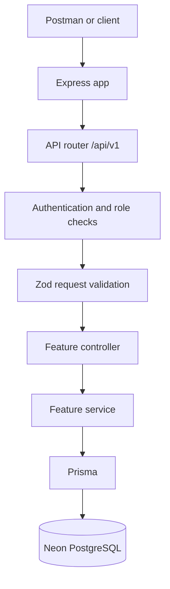
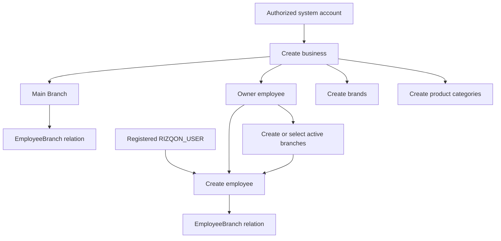

# Rizqon server

Express backend with Prisma/PostgreSQL and managed Neon Auth.
See [NEON_SETUP.md](NEON_SETUP.md) for additional Neon provisioning and
managed-auth notes.

```powershell
pnpm.cmd run build
pnpm.cmd start
```

The server starts at http://localhost:5000 by default. `neon deploy` provisions
backend services and pulls environment variables; deploy the Express process
on a Node.js host separately. For development, use `pnpm.cmd run dev`.

## Configuration and setup

Use Node.js `22.18+` (or `24.11+`) and pnpm. From the `Rizqon-server`
directory on Windows:

```powershell
pnpm.cmd install
```

Create a private `.env` file. Do not commit credentials or connection strings:

```dotenv
NODE_ENV=development
PORT=5000
DATABASE_URL=postgresql://<user>:<password>@<pooled-host>/<database>?sslmode=require
DATABASE_URL_UNPOOLED=postgresql://<user>:<password>@<direct-host>/<database>?sslmode=require
NEON_AUTH_BASE_URL=https://<your-neon-auth-url>
NEON_AUTH_JWKS_URL=https://<your-neon-jwks-url>
FRONTEND_ORIGIN=http://localhost:3000
JWT_ACCESS_TOKEN_SECRET=<random-secret-at-least-20-characters>
JWT_REFRESH_TOKEN_SECRET=<different-random-secret-at-least-20-characters>
JWT_ACCESS_TOKEN_EXPIRE_TIME=15m
JWT_REFRESH_TOKEN_EXPIRE_TIME=30d
SESSION_TOKEN_EXPIRE_TIME=7d
```

`DATABASE_URL`, `NEON_AUTH_BASE_URL`, `NEON_AUTH_JWKS_URL`, and
`FRONTEND_ORIGIN` are required by the environment validator. Use the pooled
database URL for the application; Prisma uses `DATABASE_URL_UNPOOLED` for
migrations when it is set. `PORT` defaults to `5000`. The JWT secrets are
optional in schema validation but required by the custom sign-in and protected
API flows. `src/config/env.ts` lists all supported variables and defaults.

Run and verify the server:

```powershell
pnpm.cmd run generate
pnpm.cmd run db:validate
pnpm.cmd run dev
```

For production, apply migrations with `pnpm.cmd run migrate:deploy`, build
with `pnpm.cmd run build`, then start with `pnpm.cmd start`. For more Neon
deployment and managed-auth notes, see [NEON_SETUP.md](NEON_SETUP.md).

Run static checks with:

```powershell
pnpm exec tsc --noEmit
pnpm exec eslint .
```

## Application structure and request flow

```text
src/
  app.ts                 Express setup, middleware, and /api/v1 mount
  index.route.ts         Feature route registration
  config/env.ts          Environment validation
  middleware/            Authentication, validation, and error handling
  module/
    auth/                Signup, sign-in, and verification
    bussiness/           Business lifecycle
    branch/              Branch lifecycle
    Brand/               Brand lifecycle
    Product-Category/    Product category lifecycle
    Employee/            Employee lifecycle and business permissions
prisma/                  PostgreSQL schema, migrations, generated client
```

Each feature follows the route → validation/auth middleware → controller →
service → Prisma/database flow.



### Business setup workflow



The business, branch, brand, and category CRUD routes require one of the
`RIZQON_CEO`, `RIZQON_MANAGER`, or `RIZQON_OWNER` system roles. Employee routes
require an authenticated active employee of the specified business; employee
write and detailed-read permissions also follow the hierarchy described below.

## Employee management API

The employee routes are mounted at `/api/v1/employee`. In Postman, create an
environment variable:

```text
baseUrl = http://localhost:5000/api/v1
```

For authenticated employee requests, select **Bearer Token** in Postman's
Authorization tab and provide the `accessToken` returned by sign-in. Do not put
an extra slash at the end of `baseUrl`.

### Postman setup flow

Employee creation requires an existing business, an active branch in that
business, and a registered system user to add as the employee.

1. Register the employee's system account, if it does not already exist:

   **POST** `{{baseUrl}}/auth/create-user`

   ```json
   {
     "name": "Sam Employee",
     "email": "sam@example.com",
     "password": "replace-with-a-secure-password",
     "phone": "+8801712345678"
   }
   ```

   New users default to `RIZQON_USER`. Complete email verification before
   signing in.

   Send a verification code:

   **POST** `{{baseUrl}}/auth/send-verification-otp`

   ```json
   {
     "email": "sam@example.com"
   }
   ```

   Verify the code received by email:

   **POST** `{{baseUrl}}/auth/verify-email`

   ```json
   {
     "email": "sam@example.com",
     "otp": "123456"
   }
   ```

2. Sign in as a business owner or another authorized system account:

   **POST** `{{baseUrl}}/auth/sign-in-user`

   ```json
   {
     "email": "owner@example.com",
     "password": "replace-with-a-secure-password"
   }
   ```

   Copy `data.accessToken` from the response and use it as the Bearer token.

3. If you need a new business, create it using an account with the
   `RIZQON_OWNER`, `RIZQON_CEO`, or `RIZQON_MANAGER` system role:

   **POST** `{{baseUrl}}/business/create-business`

   ```json
   {
     "business": {
       "Business_name": "Example Store",
       "business_slug": "example-store",
       "Business_phone": "+8801712345678",
       "Business_email": "store@example.com",
       "Business_Main_address": "Dhaka, Bangladesh",
       "currency": "BDT"
     },
     "employee": {
       "Employee_email": "owner@example.com"
     }
   }
   ```

   `employee.Employee_email` must belong to an existing system user with a
   phone number. Business creation creates a `Main Branch` and an `OWNER`
   employee for that user. Copy `data.business.id` and `data.branch.id` from
   the response. For an existing business, use an active branch ID belonging
   to that business.

### Employee endpoints

All IDs below are CUIDs. Employee routes require a valid Bearer access token.

| Method | URL | Request body |
| --- | --- | --- |
| `POST` | `{{baseUrl}}/employee/create-employee` | Required; see Create employee |
| `GET` | `{{baseUrl}}/employee/get-all-employees/:businessId` | None |
| `GET` | `{{baseUrl}}/employee/get-employee/:businessId/:id` | None |
| `PATCH` | `{{baseUrl}}/employee/update-employee/:businessId/:id` | Required; see Update employee |
| `DELETE` | `{{baseUrl}}/employee/delete-employee/:businessId/:id` | None |

#### Create employee

**POST** `{{baseUrl}}/employee/create-employee`

```json
{
  "businessId": "paste-business-id",
  "branchId": "paste-active-branch-id",
  "email": "sam@example.com",
  "employeeCode": "EMP001",
  "jobTitle": "HR_MANAGER",
  "baseSalary": 25000
}
```

Required: `businessId`, `branchId`, `email`, `employeeCode`, and `jobTitle`.
`baseSalary` is optional and defaults to `0`. The branch must be active and
belong to the given business. The employee email must be an existing active
`RIZQON_USER` account with a phone number, and the user cannot already be
included in that business. The employee is linked to the branch in the same
database transaction.

`jobTitle` must be one of the `EMPLOYEE_JOB_TITLE` values:
`OWNER`, `CO_OWNER`, `MANAGING_DIRECTOR`, `GENERAL_MANAGER`,
`OPERATIONS_MANAGER`, `BRANCH_MANAGER`, `ASSISTANT_MANAGER`, `SUPERVISOR`,
`HR_MANAGER`, `HR_OFFICER`, `FINANCE_MANAGER`, `SENIOR_ACCOUNTANT`,
`ACCOUNTANT`, `JUNIOR_ACCOUNTANT`, `ACCOUNTS_ASSISTANT`, `INVENTORY_MANAGER`,
`INVENTORY_OFFICER`, `WAREHOUSE_MANAGER`, `STOREKEEPER`, `STOCK_ASSISTANT`,
`PURCHASE_MANAGER`, `PURCHASE_OFFICER`, `SALES_MANAGER`, `SALES_EXECUTIVE`,
`SALES_ASSOCIATE`, `CASHIER`, `MARKETING_MANAGER`, `MARKETING_EXECUTIVE`,
`CUSTOMER_SERVICE_MANAGER`, `CUSTOMER_SERVICE_REPRESENTATIVE`,
`DELIVERY_SUPERVISOR`, `DELIVERY_PERSON`, `DRIVER`, `PACKER`, `IT_MANAGER`,
`IT_SUPPORT`, `DATA_ENTRY_OPERATOR`, `SECURITY_SUPERVISOR`, `SECURITY_GUARD`,
`CLEANER`, `OFFICE_ASSISTANT`, `INTERN`, and `OTHER`. `CEO` is a system-user
role, not an employee job title.

The employee hierarchy is Owner → Co-owner/CEO → Managing Director → other
manager job titles → all remaining job titles. An authenticated user must also
be an active employee of the business. Create, update, and delete operations
can only target employees below the actor's rank, except that employees may
update their own name and phone.

#### Get employees

- **GET all:** `{{baseUrl}}/employee/get-all-employees/:businessId`
  Returns active employees in the business. The caller must be an active
  employee of that business.
- **GET one:** `{{baseUrl}}/employee/get-employee/:businessId/:id`
  Returns the employee, business, linked user, assigned branch, and directly
  related stock movements, carts, sales, purchases, payments, sale returns,
  expenses, commission settlements, and audit logs. Only the employee
  themselves or a higher-ranked employee can view this detail response. It can
  be large when the employee has many related records.

Neither GET request requires a JSON body.

#### Update employee

**PATCH** `{{baseUrl}}/employee/update-employee/:businessId/:id`

An employee can update only their own name and phone:

```json
{
  "name": "Sam Updated",
  "phone": "+8801712345679"
}
```

A higher-ranked employee can update a lower-ranked employee using any of these
fields:

```json
{
  "name": "Sam Updated",
  "phone": "+8801712345679",
  "employeeCode": "EMP002",
  "jobTitle": "SALES_EXECUTIVE",
  "baseSalary": 30000,
  "email": "sam.new@example.com",
  "isActive": true
}
```

Send only fields to change. `email` updates the linked system user's email;
the email must not belong to another account. Changing email or phone clears
the corresponding verification state. A job-title change cannot promote the
employee to the actor's rank or higher.

#### Delete employee

**DELETE** `{{baseUrl}}/employee/delete-employee/:businessId/:id`

No JSON body is needed. This is a soft delete: it sets `isActive` to `false`
and keeps historical transaction links. Only a higher-ranked employee can
delete a lower-ranked employee.

## Business API

All business URLs start with `{{baseUrl}}/business`. These routes require an
authorized system account.

| Method | URL | Body or query |
| --- | --- | --- |
| `POST` | `/create-business` | Required; see below |
| `GET` | `/get-all-business` | None |
| `GET` | `/search-business?searchTerm=example` | Query parameter |
| `PATCH` | `/update-business/:id` | One or more business fields; see below |
| `DELETE` | `/delete-business/:id` | None |

### Create business

**POST** `{{baseUrl}}/business/create-business`

```json
{
  "business": {
    "Business_name": "Example Store",
    "business_slug": "example-store",
    "legalName": "Example Store Ltd",
    "registrationNumber": "REG-1001",
    "taxIdentificationNumber": "TIN-1001",
    "Business_phone": "+8801712345678",
    "Business_email": "store@example.com",
    "Business_Main_address": "Dhaka, Bangladesh",
    "currency": "BDT"
  },
  "employee": {
    "Employee_email": "owner@example.com"
  }
}
```

Required: `business.Business_name`, `business.business_slug`, and
`employee.Employee_email`. The owner email must already exist in the system
and have a phone number. Optional business fields are `legalName`,
`registrationNumber`, `taxIdentificationNumber`, `Business_phone`,
`Business_email`, `Business_Main_address`, and `currency` (`BDT`, `USD`, or
`EUR`; defaults to `BDT`). Creation also returns a `Main Branch`, an `OWNER`
employee, and their branch relation.

### Update business

**PATCH** `{{baseUrl}}/business/update-business/:id`

Send one or more business fields from the create example. To change the owner,
include an existing system user's email:

```json
{
  "Business_name": "Example Store Updated",
  "owner": {
    "Employee_email": "new-owner@example.com"
  }
}
```

`GET /get-all-business`, search, and delete requests need no JSON body. Search
uses the `searchTerm` query parameter.

## Branch API

All branch URLs start with `{{baseUrl}}/branch` and require an authorized
system account.

| Method | URL | Body |
| --- | --- | --- |
| `POST` | `/create-branch` | Required; see below |
| `GET` | `/get-all-branches` | None |
| `PATCH` | `/update-branch/:id` | One or more branch fields |
| `DELETE` | `/delete-branch/:id` | None |

### Create branch

**POST** `{{baseUrl}}/branch/create-branch`

```json
{
  "businessId": "paste-business-id",
  "name": "Uttara Branch",
  "branch_code": "BR001",
  "address": "Uttara, Dhaka",
  "phone": "+8801712345678",
  "isActive": true
}
```

Required: `businessId`, `name`, and `branch_code`. `address`, `phone`, and
`isActive` are optional; `isActive` defaults to `true`. Branch codes are
unique within a business.

### Update branch

**PATCH** `{{baseUrl}}/branch/update-branch/:id`

```json
{
  "name": "Uttara Branch Updated",
  "isActive": true
}
```

Send at least one of `name`, `branch_code`, `address`, `phone`, or `isActive`.
List and delete requests need no JSON body.

## Brand API

All brand URLs start with `{{baseUrl}}/brand` and require an authorized system
account.

| Method | URL | Body |
| --- | --- | --- |
| `POST` | `/create-brand` | Required; see below |
| `GET` | `/get-all-brands` | None |
| `PATCH` | `/update-brand/:id` | Required |
| `DELETE` | `/delete-brand/:id` | None |

### Create brand

**POST** `{{baseUrl}}/brand/create-brand`

```json
{
  "businessId": "paste-business-id",
  "brand_name": "Example Brand"
}
```

Both `businessId` and `brand_name` are required. The business must exist.

### Update brand

**PATCH** `{{baseUrl}}/brand/update-brand/:id`

```json
{
  "brand_name": "Updated Brand Name"
}
```

`brand_name` is required. List and delete requests need no JSON body.

## Product category API

All category URLs start with `{{baseUrl}}/category` and require an authorized
system account.

| Method | URL | Body |
| --- | --- | --- |
| `POST` | `/create-category` | Required; see below |
| `GET` | `/get-all-categories` | None |
| `GET` | `/get-category/:id` | None |
| `PATCH` | `/update-category/:id` | One or more category fields |
| `DELETE` | `/delete-category/:id` | None |

### Create category

**POST** `{{baseUrl}}/category/create-category`

```json
{
  "businessId": "paste-business-id",
  "name": "Electronics",
  "category_slug": "electronics",
  "description": "Electronic products",
  "parentId": null,
  "isActive": true
}
```

Required: `businessId`, `name`, and `category_slug`. `description`, `parentId`,
and `isActive` are optional; `isActive` defaults to `true`. If supplied,
`parentId` must refer to a category in the same business.

### Update category

**PATCH** `{{baseUrl}}/category/update-category/:id`

```json
{
  "name": "Mobile Phones",
  "category_slug": "mobile-phones",
  "description": "Phones and accessories",
  "isActive": true
}
```

Send at least one of `name`, `category_slug`, `description`, `parentId`, or
`isActive`. A category cannot be its own ancestor. List, get-one, and delete
requests need no JSON body.
